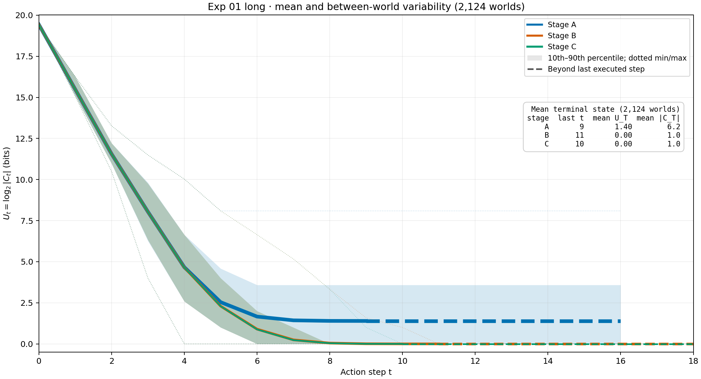
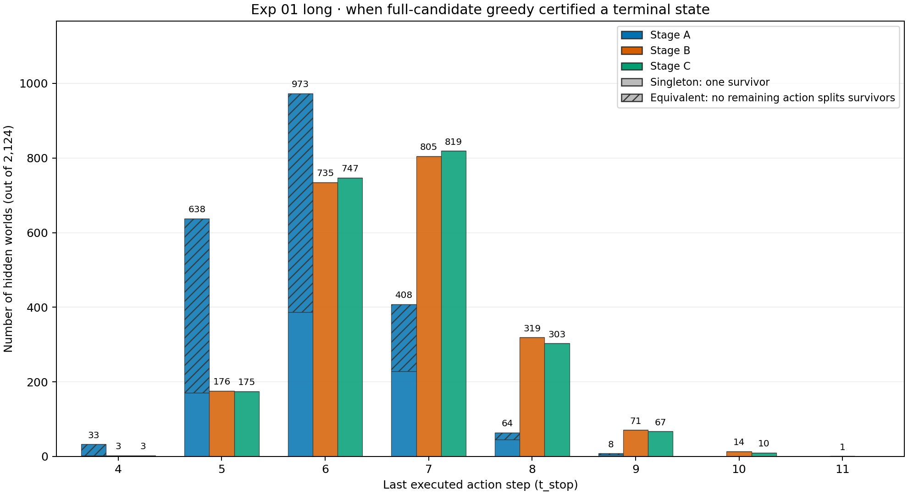

# Track 1 — Behavior of Stage A/B/C

## Question

With full-candidate greedy information gain, how does uncertainty change across Stages A, B, and C? Which terminal differences are limits of the action set, independent of the policy?

## Exp 01: sampled greedy trajectories

[Exp 01 long](exp-01-long/README.md) ran the same **2,124 sampled hidden worlds** in all three stages, with each stage's full action set and no candidate limit. A hidden world is the paired unit. The six-hour run saved complete step records; the 10-world [short run](exp-01-short/README.md) remains an exploratory trace source.

The lines show mean `U_t = log₂|C_t|`; shaded bands show the 10th–90th percentile **between worlds**, not a confidence interval for the mean. Dashed line segments extend a certified terminal state after the last executed action. Stage A levels off above zero while B/C fall close to zero in this sample.

| Stage | Available actions | Mean stop step ± sample SD | Mean final U (bits) | Final survivors, mean | Singleton endings | Equivalent endings |
| --- | ---: | ---: | ---: | ---: | ---: | ---: |
| A | 16 | 5.93 ± 0.84 | 1.396 | 6.187 | 840 (39.5%) | 1,284 (60.5%) |
| B | 144 | 6.72 ± 0.98 | 0 | 1 | 2,124 (100%) | 0 |
| C | 1,296 | 6.70 ± 0.96 | 0 | 1 | 2,124 (100%) | 0 |

“Stop” means either one survivor or a certified non-singleton class that no remaining permitted action can split. The histogram shows when that happened, rather than assigning every world its stage's maximum budget.

Most B/C actions matched: their *entire executed action-ID trace* was identical in **1,984/2,124 worlds (93.4%)**. Across all three stages, the trace patterns were A=B=C in 464 worlds (21.8%), B=C with A different in 1,520 (71.6%), and C different from both in 140 (6.6%). These counts use worlds, not action steps, as the denominator. [Trace details and raw-run links](exp-01-long/README.md) · [numeric summary](exp-01-long/numeric-summary.json).

## Exp 02: exact action-set limits

[Exp 02](exp-02/README.md) grouped **all 705,600 canonical worlds** by their responses to every action permitted in each stage. These finite-population counts are exact and independent of greedy choices or sampling. A non-singleton equivalence class is a structural ambiguity that no action in that stage can resolve.

| Stage | Response classes | Worlds in non-singleton classes | Largest class | Mean class size for an ambiguous world |
| --- | ---: | ---: | ---: | ---: |
| A | 394,684 | 424,872 (60.2143%) | 273 | 10.0209 |
| B | 705,416 | 368 (0.0522%) | 2 | 2.0000 |
| C | 705,600 | 0 | 1 | Undefined: no ambiguous worlds |

The last column samples a **world** uniformly among ambiguous worlds, so large classes receive more weight. The 2,124-world Exp 01 sample saw no Stage-B equivalent ending, but Exp 02 found 368 such worlds in the full population; sample absence is not population absence. [Exact partition and definitions](exp-02/README.md) · [machine-readable summary](exp-02/runs/20261103T121204Z/numeric-summary.json).

## Decision

Use **Stage B** as the routine `d=4,m=4` baseline: it leaves only 0.0522% of worlds structurally ambiguous, compared with 60.2143% for A, while its 144 available actions are far fewer than C's 1,296. B and C had similar sampled trajectories; C's mean stop step was only 0.024 lower, which alone is not a meaningful speed advantage. Keep C as the exact-identifiability reference.

| Fixed action budget | A: identified | B: identified | C: identified |
| ---: | ---: | ---: | ---: |
| 7 | 37.19% | 80.93% | 82.11% |
| 8 | 39.31% | 95.95% | 96.37% |
| 9 | 39.55% | 99.29% | 99.53% |

[Track 2 Exp 01](../track-2/README.md#verdict-for-subsequent-full-candidate-runs) chose **available budget 9** for Stage-B full-candidate runs: 2,109/2,124 sampled worlds were identified by action 9 versus 2,038/2,124 by action 8. Its small-prefix analysis uses 100 worlds as a practical pilot; the exploratory ±2 and ±1 percentage-point precision targets for the budget-9 identification rate first held from 300 and 700 worlds. These planning counts apply to this rate, not automatically to a new policy comparison.
