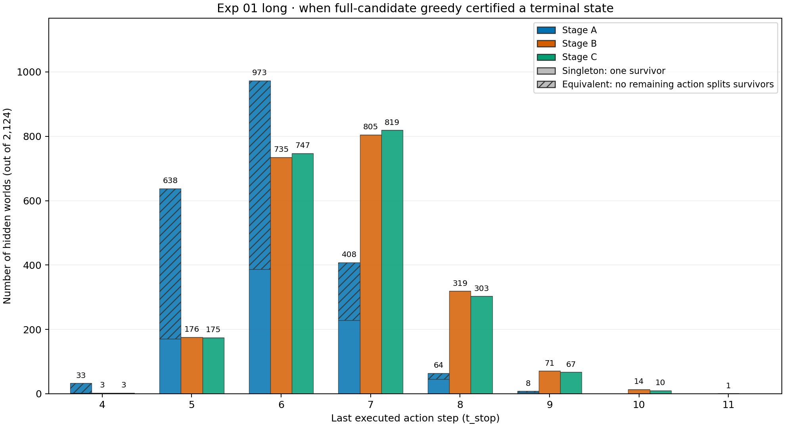
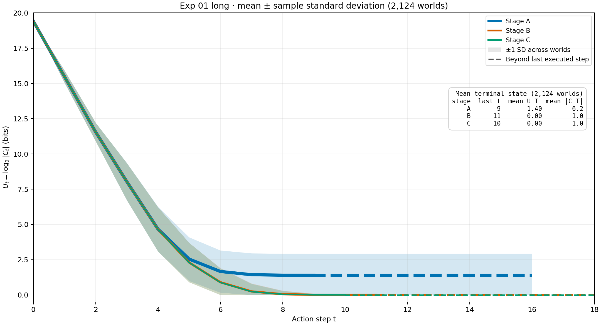

# Exp 01 long — completed sample result

Run from `src/` with `python experiment/phase-1/track-1/exp-01-long/run.py`. The script saves a random permutation of all 705,600 world indices before execution, then finishes A, B, and C for each world and syncs one raw JSONL record after every completed world. It stops between worlds after the cumulative six-hour runtime cap, so every retained world has a paired result. `--resume PATH_TO_RUN` continues an interrupted run from the saved order and checkpoint. `--hours N` changes the cap for a separate run.

The raw artifact is a timestamped directory under `runs/`. `selected_world_indices.npy` records the planned order; `metadata.json` records the completed prefix and actual elapsed time; `episodes.jsonl` holds one complete paired world per line. The shared schema is described in the [Track 1 Exp 01 README](../EXP01_RAW_SCHEMA.md).

## Result summary

The approximately six-hour run completed **2,124 paired hidden worlds** in 21,605.31 seconds. These are results for its saved random-order prefix; sampling precision and population-level claims require a separate check.

| Stage | Mean stop step ± sample SD | Mean final survivors ± sample SD |          Singleton |          Equivalent |
| ----- | -------------------------: | -------------------------------: | -----------------: | ------------------: |
| A     |                5.93 ± 0.84 |                     6.19 ± 18.93 |  840/2,124 (39.5%) | 1,284/2,124 (60.5%) |
| B     |                6.72 ± 0.98 |                         1.00 ± 0 | 2,124/2,124 (100%) |                   0 |
| C     |                6.70 ± 0.96 |                         1.00 ± 0 | 2,124/2,124 (100%) |                   0 |

**Action traces:** A=B=C in 464/2,124 worlds (21.8%); B=C but A differs in 1,520/2,124 (71.6%); C differs from both in 140/2,124 (6.6%). Within the B=C group, B/C matches A at the same executed step for an average of 76.8% of comparable actions per world (6,748/8,878, or 76.0%, when pooled across steps). Within the C-different group, C matches A on average 72.9% and B on average 74.3% of comparable actions per world. Final survivor counts match across A/B/C in 840/2,124 worlds (39.5%) and across B/C in all 2,124 worlds.

Within the 1,520 B=C-but-A-different worlds, A stopped first in 69.5%, B/C in 8.0%, and they tied in 22.4%; the signed mean gap `t_B/C - t_A` was +0.95 actions (mean absolute gap 1.13). Within the 140 C-different worlds, C stopped before B in 44.3%, B before C in 12.9%, and they tied in 42.9%; the signed mean gap `t_C - t_B` was −0.36 actions (mean absolute gap 0.61). Stopping includes either a singleton or certified equivalence, so this compares actual action counts rather than the stage budgets.
In the B=C-but-A-different group, final `U_T` was the same for A and B/C in 350/1,520 worlds (23.0%; mean signed stop gap +0.06 actions) and different in 1,170/1,520 (77.0%; mean signed gap +1.22). In the C-different group, B and C reached the same final `U_T` in all 140 worlds even though their traces differed. The [numeric summary](numeric-summary.json) gives the earlier/tie/later counts and absolute gaps within each final-`U_T` subgroup.

The action-trace categories use hidden worlds as their denominator. Action overlap compares IDs only where both stages executed an action; extra actions are counted separately in the [numeric summary](numeric-summary.json). See the [aggregate plots](visualize/README.md) and [completed run record](RUN_STATUS.md). Reproduce the numerical report from `src/` with `python experiment/phase-1/track-1/exp-01-long/summarize_raw.py`; regenerate plots with `python experiment/phase-1/track-1/exp-01-long/visualize/plot.py`.
