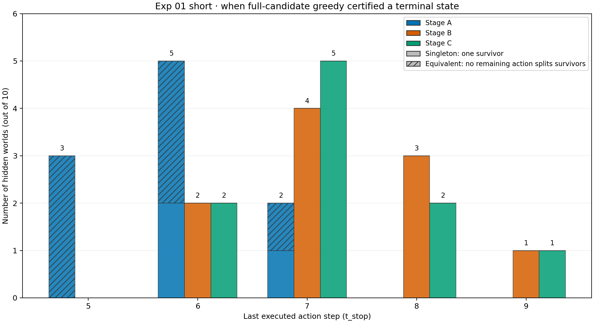
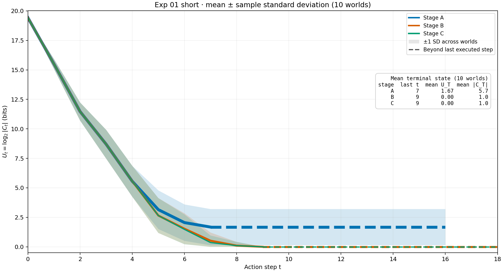

# Exp 01 short — exploratory result

## Result summary

Ten randomly sampled hidden worlds were each run in Stages A, B, and C with full-candidate greedy information gain. The hidden world is the paired unit; these ten worlds are an exploratory sample, not a population estimate.

| Stage | Mean stop step ± sample SD | Mean final survivors ± sample SD | Singleton    | Equivalent |
| ----- | -------------------------- | -------------------------------- | ------------ | ---------- |
| A     | 5.9 ± 0.74                 | 5.7 ± 8.11                       | 3/10 (30%)   | 7/10 (70%) |
| B     | 7.3 ± 0.95                 | 1.0 ± 0                          | 10/10 (100%) | 0/10       |
| C     | 7.2 ± 0.92                 | 1.0 ± 0                          | 10/10 (100%) | 0/10       |

**Action traces:** A=B=C in 2/10 worlds (20%); B=C but A differs in 7/10 (70%); C differs from both in 1/10 (10%). Within the B=C group, B/C matches A at the same executed step for an average of 83.1% of comparable actions per world (34/41, or 82.9%, when pooled across steps). In the one C-different world, C matches A on 4/5 comparable steps (80%) and B on 5/7 (71.4%). Different traces can still reach the same final state: final survivor counts match across A/B/C in 3/10 worlds and across B/C in 10/10.

Within the seven B=C-but-A-different worlds, A stopped before B/C in all seven, by 1.57 actions on average. In the one C-different world, C stopped one action before B. A stop here means either a singleton or a certified non-singleton equivalence class.
Among those seven B=C-but-A-different worlds, A and B/C ended at the same final `U_T` in 1 and different final `U_T` in 6. The one C-different world ended at the same final `U_T` in B and C despite C stopping earlier. The [numeric summary](numeric-summary.json) splits stop order and mean gap by final-`U_T` equality.

The percentages in the three action-trace categories use hidden worlds as the denominator. Action overlap compares IDs only at steps both stages executed; extra actions after one stage stopped are separate. “Equivalent” means more than one survivor remains but no permitted action can distinguish them.

## Example: episode 6 and a 28-world plateau

The hidden world in [episode 6](visualize/raw/ep-6.png) has canonical index `67917` and rules `y0 = x0 AND x2`, `y1 = x0 OR y0`, `y2 = x0 OR y0`, and `y3 = x0 AND y0`. Without forcing any `Y`, its outputs simplify to `(x0 AND x2, x0, x0, x0 AND x2)`, hiding the causal role of `y0` in `y1`, `y2`, and `y3`. In this recorded episode, Stage A stopped after 5 actions with **28 observationally equivalent survivors**; B and C reached a singleton after 8 and 7 actions. At step 5, B/C forced `y0=1` while `x0=0` and observed `(1,1,1,0)`, exposing a dependency that ordinary `do(X)` observations cannot show. This is one illustrative world, not a claim about every Stage-A plateau.

Reproduce the numbers from the saved [raw run](runs/20261103T061845Z/episodes.jsonl) with `python experiment/phase-1/track-1/exp-01-short/summarize_raw.py` from `src/`; the full machine-readable result is [`numeric-summary.json`](numeric-summary.json). See the [visualization guide](visualize/README.md) for the episode plots and histogram. To create another ten-world sample, run `python experiment/phase-1/track-1/exp-01-short/run.py` from `src/`.
