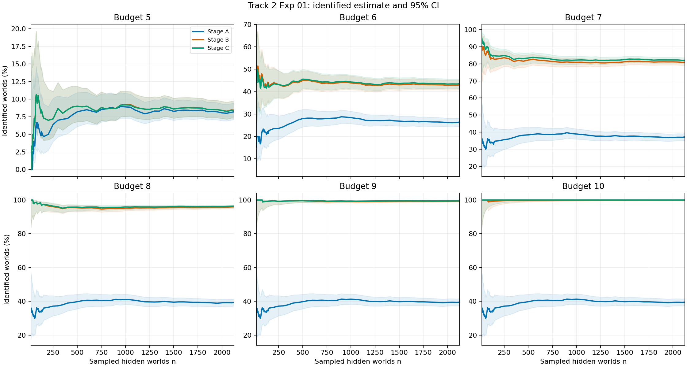
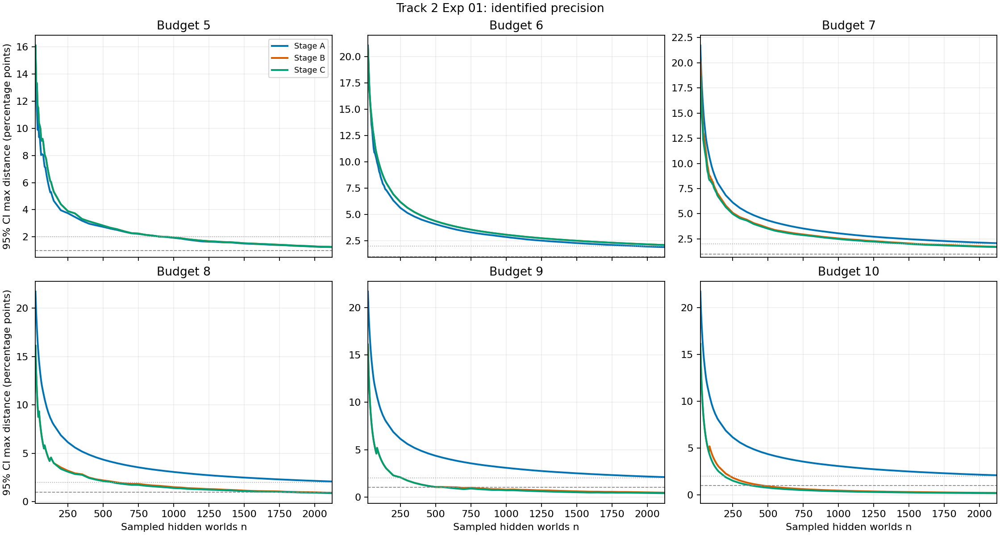
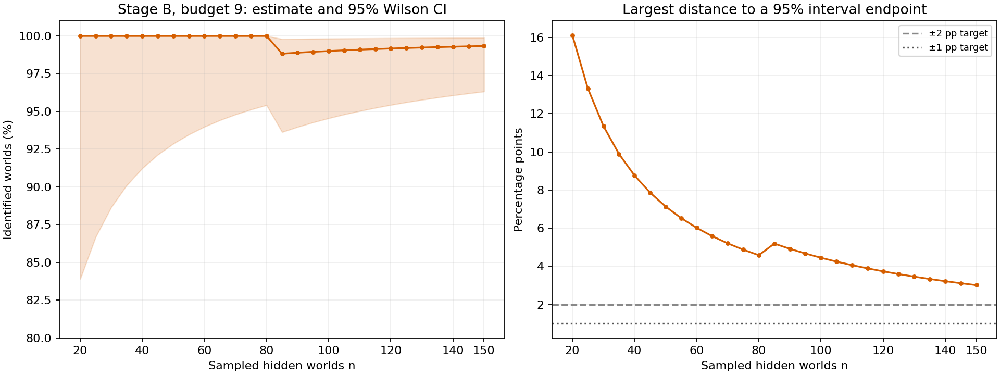
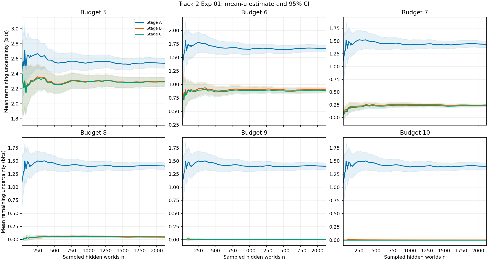
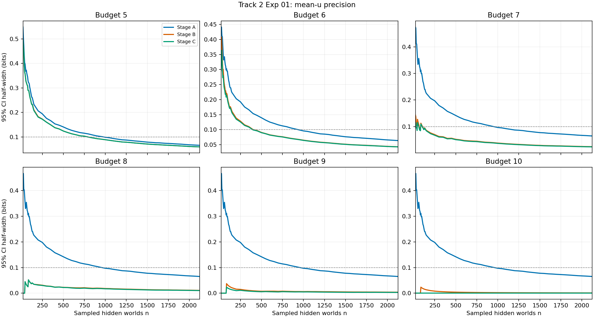

# Track 2 — Measurement precision

## Question and answer

How many independently sampled hidden worlds do we need before Stage A/B/C measurements are precise enough to inform a decision? **The answer depends on the metric and budget.** For the selected full-candidate baseline, Stage B at budget 9, this run's exploratory identification-rate targets first hold from `n=300` for ±2 percentage points and `n=700` for ±1 point; `n=100` is a practical pilot. Stage A at budgets 7–10 does not meet even ±2 points by `n=2,124`. There is no universal episode count for Phase 1.

## Exp 01 setup

This analysis, completed 3 November 2026 (Bangkok), reuses the [Track 1 Exp 01 long](../track-1/exp-01-long/README.md) raw run. Its saved random order contains 2,124 completed **paired hidden worlds**; each world has a full-candidate greedy information-gain trajectory in A, B, and C. We read the state after action budgets **5, 6, 7, 8, 9, and 10**. Values beyond an early stop are the runner's certified constant suffix, not extra executed actions. No new episode or oracle response was computed.

For each stage, budget, and sample prefix, we measure the fraction with one survivor, `P(|C_t|=1)`, and mean remaining uncertainty, `mean(log₂|C_t|)` in bits. The former answers “how often have we identified the exact world by this budget?”; the latter retains information about how much ambiguity remains when identification fails. A hidden world is the sampling unit: its three stages and repeated action steps are paired observations, not extra independent worlds. The policy is deterministic here, so the intervals measure hidden-world sampling variation; they say nothing about policy-seed variation.

We analyze prefixes of the saved random order at `n = 20, 25, …, 150, 200, 250, …, 2,100, 2,124`. Identification rates use 95% Wilson intervals, and mean uncertainty uses 95% t intervals across worlds. A 95% interval describes the behavior of the interval procedure under repeated random world samples; it does not assign a 95% probability that this particular fixed interval contains the population value. The precision target is the **largest distance from the estimate to either interval endpoint**: this matters because Wilson intervals need not be symmetric.

## Identification by action budget

Every cell below is the sampled identification rate followed by its marginal 95% Wilson interval, using all 2,124 worlds. These are six different action budgets applied to the same worlds, not six independent experiments.

| Budget | Stage A | Stage B | Stage C |
| ---: | ---: | ---: | ---: |
| 5 | 8.19% (7.10–9.44%) | 8.43% (7.32–9.69%) | 8.38% (7.28–9.64%) |
| 6 | 26.41% (24.58–28.33%) | 43.03% (40.94–45.15%) | 43.55% (41.45–45.67%) |
| 7 | 37.19% (35.16–39.27%) | 80.93% (79.21–82.55%) | 82.11% (80.42–83.68%) |
| 8 | 39.31% (37.26–41.41%) | **95.95% (95.03–96.71%)** | 96.37% (95.49–97.09%) |
| 9 | 39.55% (37.49–41.64%) | **99.29% (98.84–99.57%)** | 99.53% (99.14–99.74%) |
| 10 | 39.55% (37.49–41.64%) | 99.95% (99.73–99.99%) | 100.00% (99.82–100.00%) |

The Stage-B change from budget 8 to 9 is **2,038 → 2,109 identified worlds**, or 95.95% → 99.29% in this sample. Stage A reaches 840/2,124 (39.55%) by budget 9 and shows no further sampled gain at budget 10. This is consistent with [Track 1 Exp 02](../track-1/exp-02/README.md), which counted the action-set limit exactly across all 705,600 worlds: Stage A has 60.2143% of worlds in non-singleton equivalence classes. Exp 02's exact eventual identifiability is distinct from Exp 01's sampled success **by a particular budget**.



## How many sampled worlds are enough at each budget?

We use two checks for the word **“stable.”** First, does the estimate stay within ±1 percentage point of the final 2,124-world estimate for every later measured prefix? This describes the one saved random order and uses the final sample as a reference, not as population truth. Second, is the **entire 95% Wilson interval** within ±1 or ±2 points of its own estimate? This is the precision check. The minimum is the smallest measured prefix after which all later measured prefixes also pass; the grid advances by 5 worlds from 20 to 150 and by 50 after that, so these are planning numbers rather than exact mathematical minima.

The table gives the Wilson **precision** check for every stage and budget. Each cell is `n for ±2 pp / n for ±1 pp`; `—` means the target was not reached by 2,124 worlds.

| Budget | Stage A | Stage B | Stage C |
| ---: | ---: | ---: | ---: |
| 5 | 950 / — | 1,000 / — | 1,000 / — |
| 6 | 2,000 / — | — / — | — / — |
| 7 | — / — | 1,600 / — | 1,550 / — |
| 8 | — / — | **600 / 1,900** | 600 / 1,800 |
| 9 | — / — | **300 / 700** | 300 / 600 |
| 10 | — / — | 250 / 500 | 200 / 400 |

Stage B shows why the two checks matter. At budget 9, the estimate already happens to stay within ±1 point of its final value from the 20-world prefix, but 20 worlds give a very wide Wilson interval. It takes 700 worlds before the ±1-point **precision** target holds through all remaining measured prefixes.

| Stage B budget | Estimate stays within ±1 pp of final value from n | 95% Wilson interval stays within ±1 pp from n |
| ---: | ---: | ---: |
| 5 | 300 | — |
| 6 | 1,000 | — |
| 7 | 700 | — |
| **8** | **1,000** | **1,900** |
| **9** | **20** | **700** |
| 10 | 100 | 500 |

For budget 8, all 2,124 Stage-B worlds give 95.95% with interval 95.03–96.71%. The farthest endpoint is **0.92 percentage points** from the estimate, so it meets ±1 point. Stage A at budget 8 is 39.31% with interval 37.26–41.41%; its farthest endpoint is **2.10 points** away, so it misses ±2 points. Mean uncertainty has a different precision target, ±0.1 bit: at budget 8 it is reached from `n=1,000` for A and from `n=20` for B and C. The [full threshold table](exp-01/RESULT.md#planning-sample-sizes), [stability table](exp-01/RESULT.md#estimate-stability-versus-precision), and [machine-readable minima](exp-01/minimum-n.csv) preserve all 18 conditions.



## Verdict for subsequent full-candidate runs

**Use Stage B with an available-action budget of 9 as the working default** for this `d=4,m=4` full-candidate greedy baseline. In the 2,124-world run, budget 8 identified 2,038 worlds (95.95%), budget 9 identified 2,109 (99.29%), and budget 10 identified 2,123 (99.95%). Budget 9 adds 71 identified worlds over budget 8 while budget 10 adds another 14 over budget 9. This is a practical budget choice from the observed success/cost tradeoff, not a claim that every world is identified by action 9 or that 9 is optimal for every future question. An episode may stop before its available budget when greedy certifies a singleton or equivalence.

The closer look at `n=20,25,…,150` puts the proposed 100-world pilot inside the inspected range. A small sample is useful for piloting but cannot certify a near-99% success rate. The first 80 worlds all succeed; the first failure appears at the 85-world prefix. The resulting 95% Wilson intervals remain wide:

| Prefix n | Identified by budget 9 | Sample rate | 95% Wilson interval | Farthest endpoint |
| ---: | ---: | ---: | ---: | ---: |
| 20 | 20/20 | 100.00% | 83.89–100.00% | 16.11 pp |
| 50 | 50/50 | 100.00% | 92.87–100.00% | 7.13 pp |
| 80 | 80/80 | 100.00% | 95.42–100.00% | 4.58 pp |
| 85 | 84/85 | 98.82% | 93.63–99.79% | 5.19 pp |
| 100 | 99/100 | 99.00% | 94.55–99.82% | 4.45 pp |
| 125 | 124/125 | 99.20% | 95.61–99.86% | 3.59 pp |
| 150 | 149/150 | 99.33% | 96.32–99.88% | 3.01 pp |
| 300 | 298/300 | 99.33% | 97.60–99.82% | 1.73 pp |
| 700 | 695/700 | 99.29% | 98.34–99.70% | 0.95 pp |
| 2,124 | 2,109/2,124 | 99.29% | 98.84–99.57% | 0.46 pp |



The [complete 20–150 table in steps of 5](exp-01/RESULT.md#stage-b-budget-9-every-small-prefix) gives the counts and interval at every plotted point.

**Sample-count choice for a fresh full-candidate Stage-B budget-9 run:** use `n=100` as a practical pilot, `n=300` when a roughly ±2 percentage-point identification-rate estimate is enough, or `n=700` for the exploratory ±1-point target. `n=100` is a cost choice for a pilot, not a statistical minimum: its observed interval still extends from 94.55% to 99.82%. The ±2-point threshold first holds at 300, and the ±1-point threshold at 700 on this saved order. At approximately 10 seconds per newly computed world, these are about 17 minutes, 50 minutes, and 2 hours respectively; actual runtime depends on stages, caching, and run setup.

The existing 2,124-world full-candidate result can be reused for the same code, dataset, policy, and matched world indices, so it does not need to be recomputed merely to make a later comparison. For a new policy or condition, decide the required `n` from the **paired difference and effect size that matter to that comparison**; the 300- or 700-world budget-9 rate target is not automatically its sample-size requirement.

## Remaining uncertainty and paired stages

Mean `U_t = log₂|C_t|` is zero only if every sampled world is identified. A low mean can coexist with a few failures, so read it alongside the identification rate. The 95% t intervals below again use all 2,124 worlds.

| Budget | Stage A mean U (bits) | Stage B mean U (bits) | Stage C mean U (bits) |
| ---: | ---: | ---: | ---: |
| 5 | 2.539 (2.473–2.605) | 2.296 (2.236–2.355) | 2.293 (2.234–2.352) |
| 6 | 1.662 (1.598–1.726) | 0.898 (0.855–0.941) | 0.882 (0.839–0.924) |
| 7 | 1.433 (1.369–1.498) | 0.245 (0.221–0.270) | 0.229 (0.206–0.253) |
| 8 | 1.399 (1.334–1.464) | 0.049 (0.039–0.060) | 0.043 (0.033–0.053) |
| 9 | 1.396 (1.331–1.461) | 0.007 (0.004–0.011) | 0.005 (0.002–0.008) |
| 10 | 1.396 (1.331–1.461) | <0.001 (0–0.001) | 0 (0–0) |





Stage comparisons use a **within-world difference** before averaging; treating A, B, and C as unrelated samples would throw away the pairing. At budget 8, B−A identification is **+56.64 percentage points** (approximate 95% t interval +54.51 to +58.77), while C−B is **+0.42 points** (+0.09 to +0.76). C's sampled advantage is small in absolute size. These marginal intervals were calculated across several budgets and metrics; they should not be read as one simultaneous 95% guarantee or as a claim that C's small gain is worth its larger action space. The [paired results](exp-01/RESULT.md#paired-stage-differences-at-all-2124-worlds) give all budgets and both metrics.

## What this result supports

- **Stage B, budget 9 is the working full-candidate baseline.** The 2,124-world run supports its measured 99.29% success rate with a 98.84–99.57% marginal Wilson interval. For a fresh run, 100 worlds are a practical pilot, 300 reach the exploratory ±2-point target, and 700 reach ±1 point for this rate on the saved order.
- A single episode count cannot meet all 18 stage/budget precision targets. Conditions with success rates near the middle, such as Stage A at budgets 7–10 and Stage B/C at budget 6, need more worlds for a narrow proportion interval than near-certain conditions do.
- The prefix curves are overlapping views of one random run. A curve looking flat is not proof that its estimate equals the population value, and reshuffling these same 2,124 worlds does not create independent evidence. The post hoc planning counts may be checked on a later independent sample if a future decision needs confirmation.
- Exp 02 gives exact whole-population action-set limits, but its class partition does not give greedy success by budget. Likewise, 2,124/2,124 Stage-C successes at budget 10 in Exp 01 is a sample result, not proof that every world succeeds within 10 actions.

## Reproduce and inspect

Run from `src/`:

```powershell
python experiment/phase-1/track-2/exp-01/analyze.py
```

The script validates the Track 1 raw order and episode schema, then produces the [detailed numeric result](exp-01/RESULT.md), [stage/prefix CSV](exp-01/stage-prefix.csv), [paired/prefix CSV](exp-01/paired-prefix.csv), [minimum-n CSV](exp-01/minimum-n.csv), and the five figures above. The [analysis code](exp-01/analyze.py) reads [Track 1's completed raw run](../track-1/exp-01-long/runs/20261103T062244Z/episodes.jsonl); its SHA-256 is recorded in the result. No `core/` or policy code changed for this analysis.
